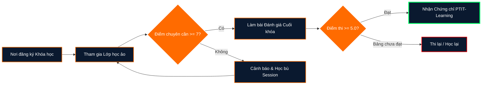

# TÀI LIỆU HƯỚNG DẪN VÀ ĐẶC TẢ YÊU CẦU DỰ ÁN PTIT-LEARNING

---

## PHẦN 1: TÀI LIỆU SRS (SOFTWARE REQUIREMENTS SPECIFICATION) - WORD
*Yêu cầu cấu trúc: Sử dụng Navigation Pane với 10 tiêu đề cấp 2 (Heading 2) dưới các phần chính.*

# 1. Giới thiệu (Introduction)
## 1.1 Mục đích tài liệu (Purpose)
Tài liệu này mô tả chi tiết các đặc tả yêu cầu phần mềm (SRS) cho module **"Học trực tuyến"** thuộc nền tảng EdTech **PTIT-Learning**. Tài liệu làm cơ sở cho đội ngũ phát triển, kiểm thử (QA/QC) và ban quản lý dự án nhằm triển khai tính năng "Lớp học ảo".

## 1.2 Phạm vi hệ thống (Scope)
Module "Học trực tuyến" tích hợp các giải pháp lớp học tương tác thời gian thực, quản lý điểm danh tự động, chia sẻ tài liệu và tương tác đa chiều giữa giảng viên và sinh viên Học viện Công nghệ Bưu chính Viễn thông (PTIT).

## 1.3 Thuật ngữ và Từ viết tắt (Definitions & Acronyms)
- **SRS**: Software Requirements Specification.
- **LMS**: Learning Management System.
- **FR**: Functional Requirement (Yêu cầu chức năng).
- **NFR**: Non-Functional Requirement (Yêu cầu phi chức năng).
- **PTIT**: Học viện Công nghệ Bưu chính Viễn thông.

---

# 2. Yêu cầu chức năng (Functional Requirements)

## 2.1 Quản lý và Khởi tạo Lớp học ảo (Virtual Classroom Management)
- **Mã yêu cầu**: `FR-VCR-01`
- **Mô tả**: Giảng viên có thể khởi tạo phòng học trực tuyến, đặt lịch học, cấu hình quyền tham gia (bật/tắt mic, camera, chia sẻ màn hình).
- **Đầu vào**: Tên lớp, Thời gian bắt đầu/kết thúc, Môn học, Danh sách SV.
- **Đầu ra**: Đường dẫn phòng học (Meeting Link) và mã PIN tham gia.

## 2.2 Điểm danh và Ghi nhận Chuyên cần Tự động (Automated Attendance Tracking)
- **Mã yêu cầu**: `FR-ATT-02`
- **Mô tả**: Hệ thống tự động ghi nhận thời gian gia nhập (Join Time), thời gian rời phòng (Leave Time) và tổng thời lượng tham gia lớp học của sinh viên.
- **Logic kinh doanh**: 
  - Nếu thời lượng tham gia $\ge 80\%$ thời lượng buổi học $\rightarrow$ Tính 1 buổi chuyên cần ($10/10$).
  - Nếu thời lượng tham gia $< 50\%$ thời lượng buổi học $\rightarrow$ Điểm chuyên cần bị trừ tương ứng.

## 2.3 Tương tác Thời gian thực (Real-time Interaction Tools)
- **Mã yêu cầu**: `FR-INT-03`
- **Mô tả**: 
  - Hỗ trợ giơ tay phát biểu (Raise Hand).
  - Khảo sát nhanh (Poll/Quiz) ngay trong buổi học.
  - Khung Chat hỗ trợ định dạng văn bản và gửi tệp tài liệu ($\le 25\text{ MB}$).

## 2.4 Ghi hình và Trích xuất Bài giảng (Session Recording & Archiving)
- **Mã yêu cầu**: `FR-REC-04`
- **Mô tả**: Buổi học tự động/thủ công được ghi lại dưới dạng FHD 1080p và lưu trữ trên Cloud Storage. Đăng tải lên LMS trong vòng $2\text{ giờ}$ sau khi kết thúc buổi học.

## 2.5 Nộp bài tập và Đánh giá (Assignment & Grading Integration)
- **Mã yêu cầu**: `FR-GRD-05`
- **Mô tả**: Cho phép giảng viên giao bài tập ngay trong lớp học ảo. Sinh viên tải lên bài làm (PDF, DOCX, ZIP). Giảng viên chấm điểm và trả phản hồi trực tiếp.

---

# 3. Yêu cầu phi chức năng (Non-Functional Requirements)

## 3.1 Hiệu năng và Độ ổn định (Performance & Scalability)
- **Mã yêu cầu**: `NFR-PER-01`
- **Mô tả**: Hệ thống chịu tải tối thiểu $5,000$ sinh viên truy cập đồng thời (Concurrent Users) không xé hình hoặc mất kết nối audio. Độ trễ video/audio (Latency) $\le 250\text{ ms}$.

## 3.2 Bảo mật và Quyền truy cập (Security & Access Control)
- **Mã yêu cầu**: `NFR-SEC-02`
- **Mô tả**: Mã hóa dữ liệu truyền tải theo chuẩn TLS 1.3 và SRTP. Xác thực người dùng qua SSO account PTIT (`@student.ptit.edu.vn`).

## 3.3 Giao diện và Trải nghiệm Người dùng (Usability & Accessibility)
- **Mã yêu cầu**: `NFR-UI-03`
- **Mô tả**: Giao diện tương thích Responsive trên Web Browser (Chrome, Firefox, Edge) và Mobile App (iOS, Android). Chuẩn WCAG 2.1 về độ tương phản và hỗ trợ người khuyết thị.

> **Lưu ý thao tác Microsoft Word:**
> 1. Đặt tất cả 10 mục dạng `1.1`, `1.2`, `2.1`,... ở cấp **Heading 2**.
> 2. Bật thanh **Navigation Pane** (Phím tắt `Ctrl + F` hoặc `View -> Navigation Pane`) để kiểm tra đúng 10 tiêu đề cấp 2.
> 3. Cập nhật Mục lục tự động: Click chuột phải vào Table of Contents $\rightarrow$ Chọn **Update Field** $\rightarrow$ Chọn **Update entire table**.

---

## PHẦN 2: THIẾT LẬP VÀ XỬ LÝ DỮ LIỆU EXCEL (AUTOFILTER)

### 2.1 Cấu trúc Bảng dữ liệu Mẫu (Data Schema)
*Hàng đầu tiên là Header Row duy nhất. Không thêm dòng trống hoặc dòng tính tổng ở giữa dữ liệu.*

| Mã SV | Họ và Tên | Tên Khóa Học | Khoa | Điểm Chuyên Cần | Trạng Thái |
| :--- | :--- | :--- | :--- | :---: | :---: |
| B21DCCN001 | Nguyễn Văn A | Lập trình Web | CNTT | 6.5 | Chưa đạt |
| B21DCCN002 | Trần Thị B | Cấu trúc dữ liệu | CNTT | 8.5 | Đạt |
| B21DCVT003 | Lê Văn C | Mạng máy tính | VT | 5.0 | Chưa đạt |
| B21DCCN004 | Phạm Hoàng D | Cơ sở dữ liệu | CNTT | 6.0 | Chưa đạt |
| B21DCAT005 | Hoàng Anh E | An toàn thông tin | ATTT | 9.0 | Đạt |
| B21DCCN006 | Vu Minh F | Trí tuệ nhân tạo | CNTT | 4.5 | Chưa đạt |
| B21DCCN007 | Đặng Thu G | Thiết kế UI/UX | CNTT | 7.0 | Đạt |

### 2.2 Quy trình thực hiện AutoFilter đa điều kiện
1. **Bước 1**: Chọn toàn bộ vùng dữ liệu hoặc đặt con trỏ tại một ô bất kỳ trong bảng dữ liệu.
2. **Bước 2**: Nhấn tổ hợp phím **`Ctrl + Shift + L`** để bật tính năng **AutoFilter** (xuất hiện mũi tên xuống ở mỗi cột trên Header Row).
3. **Bước 3 (Lọc Khoa CNTT)**: 
   - Nhấp vào nút Filter tại cột **Khoa**.
   - Bỏ chọn *(Select All)*, tích chọn **CNTT**.
4. **Bước 4 (Lọc Điểm chuyên cần < 7)**:
   - Nhấp vào nút Filter tại cột **Điểm Chuyên Cần**.
   - Chọn **Number Filters** $\rightarrow$ Select **Less Than...** (Nhỏ hơn).
   - Nhập giá trị `7` vào ô điều kiện $\rightarrow$ Bấm **OK**.

---

## PHẦN 3: KỊCH BẢN THIẾT KẾ SLIDE POWERPOINT (3-ZONE COMBO MÀU TỐI)

### 3.1 Quy chuẩn Phối màu (Dark Theme Palette)
- **Nền chính (Background)**: Dark Navy (`#0A192F` hoặc `RGB: 10, 25, 47`)
- **Văn bản & Nội dung (Text)**: Pure White (`#FFFFFF`) & Light Gray (`#E6F1FF`)
- **Màu điểm nhấn (Accent Color)**: Vibrant Orange (`#FF6B00` hoặc `RGB: 255, 107, 0`)
- **Tỷ lệ tương phản (Contrast Ratio)**: $> 7:1$ (Đạt chuẩn AAA kiểm tra khả năng đọc).

### 3.2 Bố cục Slide 3 vùng (Standard 3-Zone Layout)
```
+-------------------------------------------------------------------+
|  [VÙNG 1: HEADER ZONE]                                            |
|  Tiêu đề: LỘ TRÌNH HỌC TẬP TẠI PTIT-LEARNING                      |
+-------------------------------------------------------------------+
|  [VÙNG 2: FLOWCHART / MAIN CONTENT ZONE]                          |
|                                                                   |
|   +--------------+      +--------------+      +--------------+    |
|   | 1. Đăng ký   | ---> | 2. Học trực  | ---> | 3. Đánh giá  |    |
|   |    Khóa học  |      |    tuyến     |      |    & Cấp CC  |    |
|   +--------------+      +--------------+      +--------------+    |
|                                                                   |
+-------------------------------------------------------------------+
|  [VÙNG 3: FOOTER / TAKEAWAY ZONE]                                 |
|  Ghi chú/Takeaway: Hoàn thành 100% lộ trình để nhận chứng chỉ   |
+-------------------------------------------------------------------+
```

### 3.3 Mã biểu diễn Flowchart Lộ trình Học tập (Mermaid Diagram)



---

## BẢNG KIỂM TRA RÀNG BUỘC (CHECKLIST CUỐI CÙNG)

- [x] **Word**: Đã có đủ 10 tiêu đề Heading 2 được sắp xếp để Navigation Pane quản lý dễ dàng.
- [x] **Word**: Đã ghi chú cập nhật mục lục (`Update entire table`).
- [x] **Excel**: Đã hướng dẫn chi tiết lọc bằng `Ctrl + Shift + L` với điều kiện Điểm chuyên cần $< 7$ và Khoa = CNTT.
- [x] **Excel**: Đã đảm bảo Header Row duy nhất và không chèn hàng tổng cộng giữa danh sách.
- [x] **PowerPoint**: Đúng phối màu Combo tối (Navy, Chữ trắng, Accent Cam).
- [x] **PowerPoint**: Thiết kế Slide chuẩn 3 vùng (Header - Main Flowchart - Footer Takeaway).